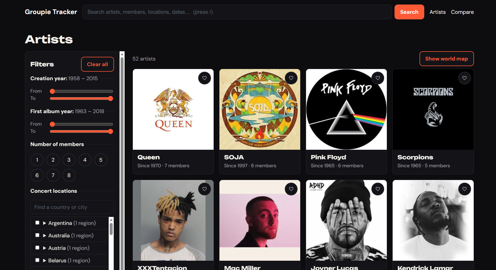
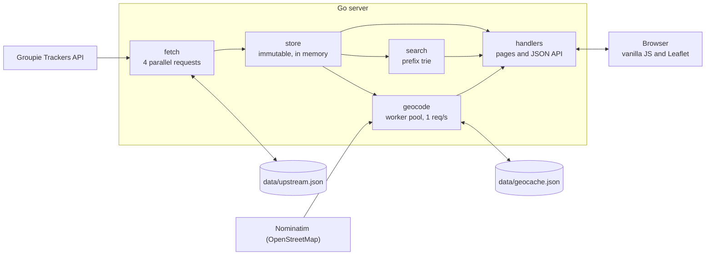
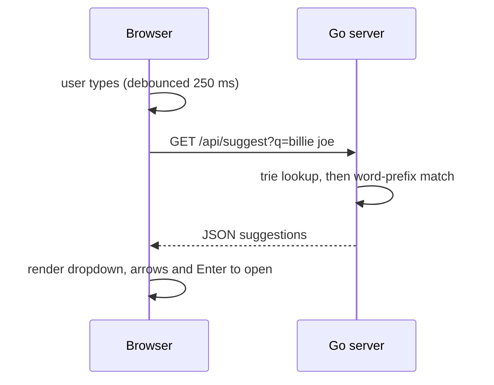

<h1 align="center">Groupie Tracker</h1>

<p align="center">
  An interactive concert tracker for music artists and bands: live search, instant filters and animated tour maps.<br>
  Server-rendered Go, standard library only, no frontend framework.
</p>

<p align="center">
  <a href="https://groupie-tracker-p7gn.onrender.com"></a>
  
  
  
  
</p>

<p align="center">
  
</p>

**[Live demo](https://groupie-tracker-p7gn.onrender.com)** · [Features](#features) · [Architecture](#architecture) · [Getting started](#getting-started) · [API](#http-api) · [Team](#team)

> The demo runs on a free Render instance that sleeps after 15 minutes without traffic.
> The first request after a pause can take 30 to 60 seconds.

---

## About

Groupie Tracker turns the *Groupie Trackers* REST API (artists, concert locations, dates and the relations between them) into a searchable, filterable website with an interactive concert map for every artist.

The server plays both roles of the client-server model. At startup it is a **REST client**: it fetches the API in parallel, joins the four datasets into one model and keeps it in memory. At runtime it is a **REST server**: it renders HTML pages and answers small JSON requests that the browser makes while the user types, filters or opens a map.

It was built as a team project for the Zone01 Athens curriculum. The mandatory subject was extended with the four optional ones: search bar, geolocalization, filters and visualizations.

## Features

### Browse and filter
- Responsive card grid with image, formation year and member count
- **Live filters, no page reload:** formation year range, first album year range, number of members, and a concert location tree (Country → State/Region → City)
- Filters combine with AND, and several selected locations combine with OR
- Filter state lives in the URL, so the back button and shared links restore it. "Clear all" resets everything

### Search
- **Live suggestions** while you type, debounced and labelled by type: artist, member, location, creation year, first album date
- Case-insensitive, prefix-based, and multi-word aware (`billie joe`, `london-uk`, `05-08-1967`)
- Keyboard friendly: `/` focuses the search box, arrows move, `Enter` opens, `Esc` closes
- The search form is a plain `GET /search`, so full results also work without JavaScript

### Maps
- Per-artist tour map (Leaflet and OpenStreetMap) with **numbered markers in chronological order** joined by a path
- **Tour distance** in kilometres and an **animated tour playback** (play, pause, replay)
- **World map** of every concert location, following the active filters
- Locations are geocoded in the background, so the site is usable immediately while the maps fill in

### Extras
- **Compare** two artists side by side: location count, total shows and tour distance
- **Favorites**, stored in the browser, with a favorites-only toggle
- Custom 400, 404 and 500 pages that share the site layout
- Responsive from 320 px to wide desktop, with WCAG AA text contrast and `prefers-reduced-motion` support

<details>
<summary><b>Screenshots</b></summary>

| Artist page and tour map | Live filters |
|---|---|
|  |  |

| Compare artists | World map |
|---|---|
|  |  |

| Mobile |
|---|
|  |

</details>

## Architecture



**Request flow of a live search** (the client-server event of the project):



| Package | Responsibility |
|---|---|
| `cmd/server` | Startup sequence and routing. No business logic |
| `internal/fetch` | API client that fetches the four endpoints in parallel, plus the on-disk snapshot fallback |
| `internal/store` | Joins the raw data into one view per artist; filters, tour distance, map points |
| `internal/search` | Prefix-search trie over names, members, locations and dates |
| `internal/geocode` | Nominatim client, worker pool, shared rate limiter and disk cache |
| `internal/handlers` | HTML pages, JSON API, error pages, panic recovery |
| `web/` | `html/template` pages, CSS and vanilla JavaScript |

## Engineering highlights

- **Concurrency with a rate limit.** The four API endpoints are fetched in parallel over channels. Geocoding runs in a background worker pool behind a single shared ticker, which keeps the whole process at 1 request per second as Nominatim's usage policy requires. The server starts serving immediately and the map endpoints report `ready: false` until coordinates are available.
- **Immutable store.** The dataset is built once at boot and only read afterwards, so request handlers need no locks for artist data. The only shared mutable state, the geocoded coordinates, sits behind a `sync.RWMutex`.
- **Resilient by design.** Every successful fetch is saved atomically (temporary file, then rename) to `data/upstream.json`. If the API is unreachable or returns no artists at boot, the server starts from that snapshot instead. A corrupted geocode cache is deleted and rebuilt. A failed geocode drops one marker and never a request.
- **Safe rendering.** Pages are rendered into a buffer first and written only on success, so a template error can never send a half-written page and the status code is always correct. A `Recover` middleware turns a panic in any handler into a clean 500 page, and static folders answer 404 instead of a directory listing.
- **Search that behaves.** Every word of every name, member, location and date is a trie key, so `japan` finds `saitama-japan`. Multi-word queries require every word to match, and results are sorted deterministically.
- **A Nominatim quirk worth knowing.** The order of the query parameters changed the result: with `addressdetails` before `limit`, many locations came back empty. The client keeps the working order and documents it.
- **Tests without a network.** Both external APIs are replaced by `httptest` servers, so the suite runs offline and is checked with the race detector.

## Getting started

### Prerequisites
- Go 1.25 or later
- An internet connection for the first start (the API, Nominatim and the map tiles)

### Run

```bash
git clone https://github.com/nikospanagopoulos/groupie-tracker.git
cd groupie-tracker
go run ./cmd/server
```

Run it from the repository root: the server reads `web/` and `data/` with relative paths. Then open <http://localhost:8080>.

### Configuration

| Setting | Default | Description |
|---|---|---|
| `PORT` | `8080` | HTTP port, for example `PORT=9090 go run ./cmd/server`. Hosting platforms set it automatically |
| `data/upstream.json` | committed | Snapshot of the API data, written on every successful fetch and used if the API is down at boot |
| `data/geocache.json` | committed | Cache of geocoded coordinates |

The first start on an empty cache geocodes about 190 locations at 1 request per second, which takes a few minutes while the maps show a loading message. Every later start is near-instant. Both data files are committed, so a fresh clone or a new deploy starts ready to go.

### Tests

```bash
gofmt -l .                 # prints nothing when the code is formatted
go vet ./...
go test -race -cover ./...
```

### Deploy

The app runs on Render's free tier with the build command `go build -o server ./cmd/server` and the start command `./server`. The disk there is ephemeral, which is why the snapshot and the geocode cache stay in the repository.

## HTTP API

All routes are `GET`; the application is read-only.

**Pages**

| Route | Description |
|---|---|
| `/` | Home: artist cards, filters, world map |
| `/artist/{id}` | Artist page with members, concerts and tour map |
| `/search?q=` | Full-page search results |
| `/compare?a=ID&b=ID` | Two artists side by side |
| `/static/*` | CSS and JavaScript |

**JSON** (errors are JSON too, for example `{"error":"creation_min must be a whole number"}` with status 400)

| Route | Description |
|---|---|
| `/api/suggest?q=` | Up to 10 typed suggestions |
| `/api/filter?...` | IDs of the artists that match the filters |
| `/api/artist/{id}/geo` | Chronological coordinates and total distance for one artist |
| `/api/geo` | Every geocoded location with the artists that played there |

`/api/filter` accepts `creation_min`, `creation_max`, `first_album_min`, `first_album_max`, `members` (comma separated) and a repeatable `location`. A missing parameter means "no filter" and a malformed one returns 400.

<details>
<summary><b>Example requests</b></summary>

```bash
curl "http://localhost:8080/api/suggest?q=billie%20joe"
```
```json
[{"value":"Billie Joe Armstrong","type":"member","context":"Member of Green Day","artist_id":44}]
```

```bash
curl "http://localhost:8080/api/filter?creation_min=1995&creation_max=2000"
```
```json
{"artist_ids":[2,21,22,32,35,39,41,43,46],"total":9}
```

```bash
curl "http://localhost:8080/api/artist/1/geo"
```
```json
{"ready":true,"coordinates":[{"location":"osaka-japan","lat":34.69,"lng":135.50,"city":"Osaka","state":"Osaka Prefecture","country":"Japan","resolved":true}],"distance_km":0}
```
(shortened: the real response lists every concert location in chronological order and the real total distance.)

</details>

## Project structure

```
groupie-tracker/
├── cmd/server/          # startup and routing
├── internal/
│   ├── fetch/           # API client and snapshot fallback
│   ├── store/           # combined data, filters, tour distance
│   ├── search/          # prefix-search trie
│   ├── geocode/         # Nominatim client, worker pool, disk cache
│   ├── handlers/        # pages, JSON API, error pages, recovery
│   └── models/          # shared types
├── web/
│   ├── templates/       # HTML pages (html/template)
│   └── static/          # css/ and js/
├── data/                # upstream.json and geocache.json
└── docs/                # PRD.md and TASK_CARDS.md
```

The product requirements and task breakdown are in [`docs/PRD.md`](docs/PRD.md) and [`docs/TASK_CARDS.md`](docs/TASK_CARDS.md).

## Known limitations

- On the very first start the server needs the Groupie Trackers API, unless a `data/upstream.json` snapshot is present.
- Artist images are served by the API host, so they do not load when that host is down.
- Some location names in the API are inconsistent (for example `toronto-usa`), so a marker lands wherever Nominatim places that text.
- Tour distance and the tour path are straight lines between locations, not routes.
- On the free Render tier the first request after idle time is slow.

## Team

A Zone01 Athens team project.

| Zone01 login | Focus |
|---|---|
| **npanagopoul** ([Nikolaos Panagopoulos](https://github.com/nikospanagopoulos)) | HTTP server and routing, page handlers, JSON API, error handling and panic recovery |
|| **dsakkas** ([Dimitris Sakkas](https://github.com/dimsakkas)) | Data models, `fetch`, `geocode`, `store`, `search` |
| **dpavaloa** ([Dimitris Pavaloaia](https://github.com/Mimispavo)) | HTML templates, CSS, JavaScript (autocomplete, live filtering, maps) |

Tests and documentation were written by the whole team.

## Acknowledgements

- The *Groupie Trackers* API, provided by Zone01 / 01 Edu
- Geocoding by [Nominatim](https://nominatim.org), map data © [OpenStreetMap](https://www.openstreetmap.org/copyright) contributors
- Maps rendered with [Leaflet](https://leafletjs.com)